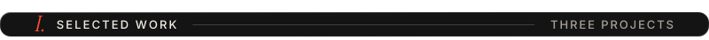
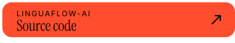
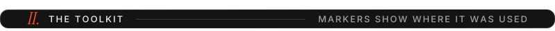
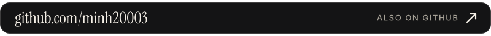

<picture><source media="(max-width: 1011px)" srcset="assets/hero-m.svg"></picture>
 
<a href="https://www.linkedin.com/in/quang-minh-dinh-0b4380359/"><picture><source media="(max-width: 1011px)" srcset="assets/tile-linkedin-m.svg"></picture></a><a href="https://github.com/minh20003"><picture><source media="(max-width: 1011px)" srcset="assets/tile-github-m.svg"></picture></a>
 
<picture><source media="(max-width: 1011px)" srcset="assets/ch-work-m.svg"></picture>
 
<picture><source media="(max-width: 1011px)" srcset="assets/linguaflow-m.svg"></picture>
 
<a href="https://c3-lingua-flow-217.dquangminh2003.id.vn"><picture><source media="(max-width: 1011px)" srcset="assets/bar-demo-m.svg"></picture></a><a href="https://github.com/minh20003/linguaflow-ai"><picture><source media="(max-width: 1011px)" srcset="assets/bar-source-m.svg"></picture></a>
 
<picture><source media="(max-width: 1011px)" srcset="assets/nexora-m.svg"></picture>
 
<picture><source media="(max-width: 1011px)" srcset="assets/sport-m.svg"></picture>
 
<a href="https://github.com/minh20003/SportFieldBookingApp"><picture><source media="(max-width: 1011px)" srcset="assets/bar-app-m.svg"></picture></a><a href="https://github.com/minh20003/htdocs"><picture><source media="(max-width: 1011px)" srcset="assets/bar-backend-m.svg"></picture></a>
 
<picture><source media="(max-width: 1011px)" srcset="assets/ch-stack-m.svg"></picture>
 
<picture><source media="(max-width: 1011px)" srcset="assets/stack-m.svg"></picture>
 
<a href="https://www.linkedin.com/in/quang-minh-dinh-0b4380359/"><picture><source media="(max-width: 1011px)" srcset="assets/connect-m.svg"></picture></a>
 
<a href="https://github.com/minh20003"><picture><source media="(max-width: 1011px)" srcset="assets/bar-github-m.svg"></picture></a>

