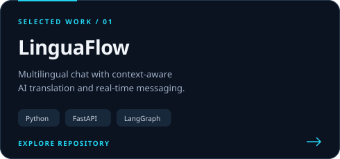
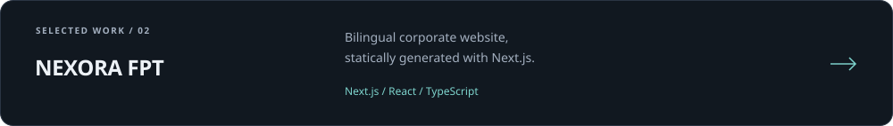
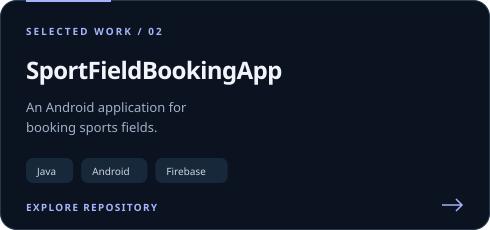
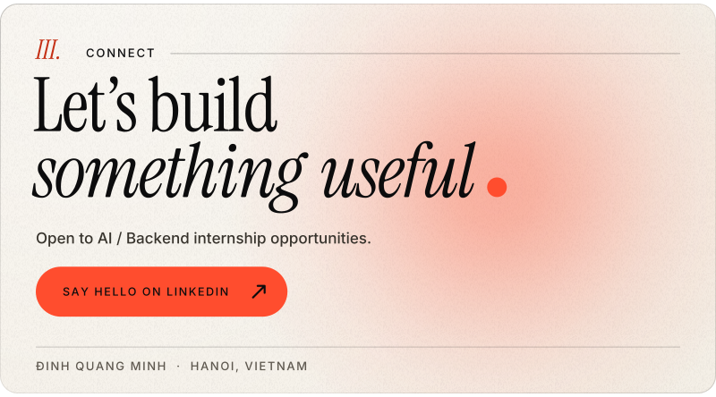

  <picture><source media="(max-width: 600px)" srcset="assets/header-mobile.svg" /></picture>
  <a href="https://github.com/minh20003/linguaflow-ai"><picture><source media="(max-width: 600px)" srcset="assets/linguaflow-mobile.svg" /></picture></a>
  <a href="https://github.com/minh20003/nexora-fpt"><picture><source media="(max-width: 600px)" srcset="assets/nexora-mobile.svg" /></picture></a>
  <a href="https://github.com/minh20003/SportFieldBookingApp"><picture><source media="(max-width: 600px)" srcset="assets/sportfield-mobile.svg" /></picture></a>
  <a href="https://www.linkedin.com/in/quang-minh-dinh-0b4380359/"><picture><source media="(max-width: 600px)" srcset="assets/connect-mobile.svg" /></picture></a>

